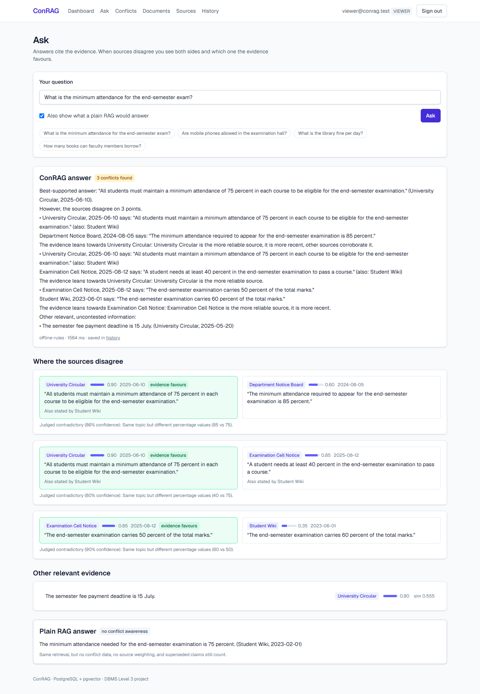

# ConRAG

**A contradiction-aware retrieval-augmented generation system.** When the documents in a knowledge base disagree, a normal RAG system retrieves one of them and answers confidently. ConRAG finds the conflict when a document is ingested, stores it as data, and at question time answers with both sides, the sources behind each, and which side the evidence favours. Admins can resolve conflicts, and resolved-away claims stop being retrieved.

DBMS Experiential Learning, Level 3 project (PES University). Stack: **Next.js 16** (App Router, Route Handlers) · **PostgreSQL 17 + pgvector** · local embeddings (MiniLM, 384-d) · optional free-tier language model (Groq, Google Gemini or OpenRouter) for claim extraction, judging and answers. No paid API is needed.



## What it does

| | |
|---|---|
| **Ingest** | Upload text. It is chunked, embedded, split into atomic claims, compared with the nearest claims from other documents, and each pair is judged *contradicts / supports / neutral*. One transaction writes it all. |
| **Ask** | Retrieves the nearest active claims, groups claims that corroborate each other into one side, finds contradictions between sides, weights them by source reliability, recency and corroboration, and answers with both sides. A toggle shows what a plain RAG would have said. |
| **Review** | Admins keep one side of a conflict (the other is superseded), dismiss false alarms, or undo a resolution. Every change is audited by database triggers. |
| **Search** | Full-text search over documents (tsvector + GIN) and vector search over claims (pgvector HNSW). |
| **Roles** | `admin` (everything), `analyst` (ingest, ask), `viewer` (ask, read). |

The evaluation on a labelled corpus (see [docs/EVALUATION.md](docs/EVALUATION.md)): ConRAG told the user the sources disagree on 16 of 16 questions with a real conflict and leaned to the better-supported side on 16 of 16; plain RAG gave the better-supported answer on 8 of 16 and never warned. Contradiction detection: precision 0.85, recall 1.00 with the rule-based fallback judge.

## Quick start

Needs Node 20+. No Docker needed for development.

```bash
npm install
cp .env.example .env        # then set SESSION_SECRET and SEED_PASSWORD
npm run db:dev              # terminal 1: Postgres + pgvector on 127.0.0.1:5433 (leave running)
```

In a second terminal:

```bash
npm run db:migrate          # applies db/migrations/*.sql
npm run db:seed             # demo users and sources
npm run demo:load           # ingests the 19 demo documents (first run downloads the ~25 MB embedding model)
npm run dev                 # http://localhost:3000
```

Sign in as `admin@conrag.test`, `analyst@conrag.test` or `viewer@conrag.test` with the `SEED_PASSWORD` from your `.env`. Then follow [docs/DEMO.md](docs/DEMO.md).

**Real PostgreSQL instead of the in-process one:** `docker compose up -d`, then use `DATABASE_URL=postgres://postgres:<POSTGRES_PASSWORD>@localhost:5433/conrag`. The schema is plain PostgreSQL + pgvector either way.

**Use a language model (free tiers only):** in `.env` set `LLM_PROVIDER=groq` (or `gemini`, `openrouter`) and `LLM_API_KEY=<your free key>`. Without them the app uses the built-in rule-based judge and template answers, which is enough to run everything. Free tiers rate-limit, so ingest keeps model calls to 2 at a time, retries with backoff, and falls back to the rule-based answer if the quota runs out. Model names change; override them with `LLM_FAST_MODEL` / `LLM_ANSWER_MODEL`.

## Commands

| Command | What it does |
|---|---|
| `npm run dev` / `build` / `start` | Next.js |
| `npm run db:dev` | Dev database (PGlite: real Postgres in WASM + pgvector), data in `.pgdata/` |
| `npm run db:migrate` | Apply migrations (`-- --reset` variant: `npm run db:reset` drops everything first) |
| `npm run db:seed` / `demo:load` | Demo users, sources, documents |
| `npm test` | 72 database, unit, language-model-provider, pipeline and query-pack tests on an in-memory Postgres |
| `npm run test:e2e` | Builds, then 18 browser tests (Edge/Chrome) on the production server; refreshes `docs/screenshots` |
| `npm run eval` | Evaluation harness; rewrites `docs/EVALUATION.md` |
| `npm run docs` | Regenerates the data dictionary and query pack from the live database |
| `npm run lint` / `typecheck` | ESLint, `tsc --noEmit` |

## Documentation

| | |
|---|---|
| [docs/PLAN.md](docs/PLAN.md) | Problem, objectives, scope, functional requirements, phases, status |
| [docs/ARCHITECTURE.md](docs/ARCHITECTURE.md) | Components, data flow, ingest and ask pipelines, scoring |
| [docs/DESIGN.md](docs/DESIGN.md) | Database choice and justification, relational schema, vector data model, integrity design, decisions |
| [docs/er-diagram.md](docs/er-diagram.md) | ER diagram (also `er-diagram.png`) |
| [docs/DATA-DICTIONARY.md](docs/DATA-DICTIONARY.md) | Every table, column, constraint, index, trigger, function (generated) |
| [docs/QUERIES.md](docs/QUERIES.md) | Important queries with real output and index plans (generated) |
| [docs/API.md](docs/API.md) | HTTP endpoints, roles, error model |
| [docs/SECURITY.md](docs/SECURITY.md) | Authentication, authorisation, validation, secrets, known limits |
| [docs/TESTING.md](docs/TESTING.md) | Test strategy and results |
| [docs/EVALUATION.md](docs/EVALUATION.md) | ConRAG vs plain RAG on a labelled corpus (generated) |
| [docs/DEMO.md](docs/DEMO.md) | Script for the final demonstration |
| [docs/requirements-map.md](docs/requirements-map.md) | Each item of the course brief and where it is satisfied |

## Layout

```
db/migrations/     versioned DDL, functions, triggers, views (001-004)
db/queries.sql     the documented query pack (executed by the tests)
db/reset.sql       DROP everything
src/app/           Next.js pages and /api route handlers
src/components/    UI components (server and client)
src/lib/           ingest, ask, judge, embeddings, auth, db, validation
scripts/           migrate, seed, dev-db, test runners, eval, docs generators
tests/             node:test suites; tests/e2e has the browser tests
eval/              demo corpus, source list, labelled pairs and questions
docs/              documentation and screenshots
```
