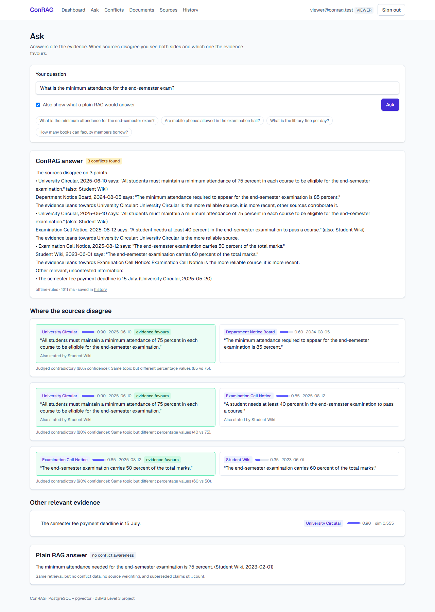
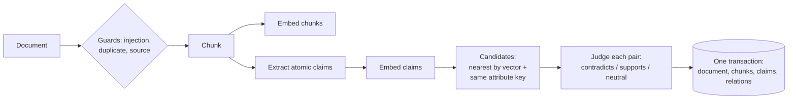
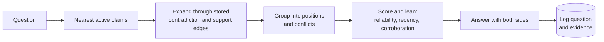

<div align="center">

# ConRAG

**Retrieval-augmented generation that notices when your sources disagree.**

[](https://github.com/santoshcheethiralame-dot/ConRAG/actions/workflows/ci.yml)
[](LICENSE)
[](https://nodejs.org)
[](https://nextjs.org)
[](https://github.com/pgvector/pgvector)

[Quick start](#quick-start) ·
[How it works](#how-it-works) ·
[Configuration](#configuration) ·
[API](docs/API.md) ·
[Documentation](docs/README.md) ·
[Contributing](CONTRIBUTING.md)



</div>

---

A conventional RAG system retrieves the top few passages and answers from them. When two documents in the knowledge base contradict each other, it picks one and answers with full confidence, and the user never learns that a conflict existed.

ConRAG treats **conflicts as data**. It finds them once, when a document is ingested, stores them in PostgreSQL next to the claims, sources and vectors they refer to, and uses them at question time to answer with *both* sides, the source behind each, and an explanation of which side the evidence favours. Administrators can resolve conflicts, and a resolved-away claim stops being retrieved.

> **Example.** A 2025 university circular says the minimum attendance for the end-semester exam is 75 %. A department notice says 85 %. A plain RAG returns whichever chunk ranked first. ConRAG answers: *"The sources disagree. The University Circular (2025) says 75 %, the Department Notice Board says 85 %. The evidence leans towards the circular: it is the more reliable source and a third source corroborates it."*

> **Status.** ConRAG is a working, tested system built as a database-systems course project (v0.1.0). It is not hardened for production use: see [Known limitations](docs/SECURITY.md#known-limits-honest-list) and the [roadmap](docs/ROADMAP.md).

## Table of contents

- [Features](#features)
- [How it works](#how-it-works)
- [Quick start](#quick-start)
- [Configuration](#configuration)
- [Usage](#usage)
- [Evaluation](#evaluation)
- [Project layout](#project-layout)
- [Development](#development)
- [Troubleshooting](#troubleshooting)
- [Documentation](#documentation)
- [Security](#security)
- [Contributing](#contributing)
- [License](#license)
- [Acknowledgements](#acknowledgements)

## Features

| | |
|---|---|
| **Conflict detection at ingest** | Documents are chunked, embedded and split into atomic claims. Each new claim is compared with candidate claims from other documents and each pair is judged *contradicts*, *supports* or *neutral*. Everything is written in one transaction. |
| **Candidates that embeddings miss** | Candidates come from vector similarity **and** from an exact, indexed *attribute key*, so "the fine is Rs 2 per day" and "for every book, Rs 5 per day is the fine" are compared even when their embeddings are far apart. |
| **Both sides in the answer** | Claims that corroborate each other form one *position*; positions joined by a contradiction form one *conflict*. Answers state each side, its source and date, and a justified lean (or *undecided* when the evidence is within 10 %). |
| **The opposing claim is always fetched** | A claim that contradicts a retrieved claim is pulled in through the stored relation even when it ranks outside the top-k. |
| **Evidence-weighted** | Claims are scored by similarity × source reliability × recency × corroboration. Reliability falls when a source's claims keep losing resolved conflicts. |
| **Human in the loop** | Admins keep one side, dismiss false alarms, or undo a resolution. Database triggers supersede the loser, reactivate it on undo, and audit every change. |
| **Integrity in the database** | CHECK constraints, composite foreign keys, six triggers and stored functions enforce the rules where the application cannot bypass them. Tests try to break each one. |
| **Runs without any paid API** | A rule-based judge and template answers work offline. An optional free-tier chat model (Groq, Gemini or OpenRouter) upgrades claim extraction, judging and answers. |
| **Plain-RAG comparison** | One toggle shows what an ordinary RAG would have answered from the same data. |
| **Full-text and vector search** | `tsvector` + GIN over documents, pgvector HNSW over claims. |
| **Role-based access** | `admin`, `analyst` and `viewer`, enforced in every route handler and page. |

## How it works

### Ingest



All slow work (embedding, model calls) happens before the transaction starts, so no database connection is held open while waiting, and a failure leaves nothing behind.

### Ask



### Resolve

An admin keeps one side of a conflict. The only thing the application does is `INSERT INTO conflict_resolutions`. The database does the rest: a trigger validates the choice, another supersedes the losing claim, and a third writes the audit row. Deleting the resolution reactivates the claim. Retrieval and source reliability react immediately.

The pipelines are described step by step in [docs/ARCHITECTURE.md](docs/ARCHITECTURE.md). The schema, the choice of PostgreSQL + pgvector over a separate vector store, and every design decision are in [docs/DESIGN.md](docs/DESIGN.md).

## Quick start

**Prerequisites:** Node.js 20 or newer. Docker is optional.

```bash
git clone https://github.com/santoshcheethiralame-dot/ConRAG.git
cd ConRAG
npm install
cp .env.example .env
```

Edit `.env` and set `SESSION_SECRET` (32 or more random characters, for example `openssl rand -hex 32`) and `SEED_PASSWORD` (8 or more characters; the password of the demo users).

Start the development database and leave it running:

```bash
npm run db:dev
```

PostgreSQL 17 with pgvector runs in-process (PGlite), so Docker is not needed. Data is kept in `.pgdata/`.

In a second terminal, create the schema, load the demo data and start the app:

```bash
npm run db:migrate
npm run db:seed
npm run demo:load
npm run dev
```

The first `demo:load` downloads the ~25 MB embedding model once. Open <http://localhost:3000> and sign in as `admin@conrag.test`, `analyst@conrag.test` or `viewer@conrag.test` with your `SEED_PASSWORD`. [docs/DEMO.md](docs/DEMO.md) is an eight-minute guided tour.

<details>
<summary><strong>Use a real PostgreSQL server instead</strong></summary>

```bash
docker compose up -d
```

Then set `DATABASE_URL=postgres://postgres:<POSTGRES_PASSWORD>@localhost:5433/conrag` in `.env`. The compose file uses the `pgvector/pgvector:pg17` image. The schema is plain PostgreSQL plus the `vector` extension (HNSW indexes need pgvector 0.5 or newer), and migrations are applied the same way (`npm run db:migrate`).

</details>

<details>
<summary><strong>Use a language model (free tiers only)</strong></summary>

In `.env`:

```ini
LLM_PROVIDER=groq        # or: gemini, openrouter
LLM_API_KEY=<your free key>
```

Free tiers rate-limit, so ingest keeps model calls to two at a time, retries with backoff, and falls back to the rule-based answer if a quota runs out. Model names change; override them with `LLM_FAST_MODEL` and `LLM_ANSWER_MODEL`. Any OpenAI-compatible endpoint also works through `LLM_BASE_URL`.

</details>

## Configuration

All configuration comes from environment variables, validated at first use ([`src/lib/env.ts`](src/lib/env.ts)). Empty values mean "unset". Nothing is hard-coded.

| Variable | Default | Description |
|---|---|---|
| `DATABASE_URL` | required | PostgreSQL connection string. |
| `SESSION_SECRET` | required | At least 32 characters; signs the session cookie. |
| `SEED_PASSWORD` | none | Password for the demo users created by `npm run db:seed`. |
| `LLM_PROVIDER` | `offline` | `offline`, `groq`, `gemini` or `openrouter`. |
| `LLM_API_KEY` | none | Required for every provider except `offline`. |
| `LLM_BASE_URL` | provider preset | Override the endpoint (any OpenAI-compatible API). |
| `LLM_FAST_MODEL` / `LLM_ANSWER_MODEL` | provider preset | Model for extraction and judging / for answers. |
| `LLM_CONCURRENCY` | `2` | Parallel model calls during ingest (1 to 8). |
| `EMBEDDING_PROVIDER` | `local` | `local` (MiniLM, transformers.js) or `hash` (lexical, no download; for tests and offline use). |
| `RETRIEVAL_K` | `8` | Claims retrieved per question. |
| `MIN_SIMILARITY` | `0.35` | Minimum question-to-claim cosine similarity. |
| `CONFLICT_MIN_SIMILARITY` | `0.5` | A conflict is reported only if one side is at least this close to the question. |
| `CANDIDATE_MIN_SIMILARITY` | `0.6` | Similarity floor for the vector shortlist at ingest. |
| `CANDIDATES_PER_CLAIM` | `5` | Vector candidates judged per new claim (attribute-key matches are added on top). |
| `SUPPORT_MIN_CONFIDENCE` | `0.7` | A *supports* edge below this neither merges positions nor counts as corroboration. |
| `EXPAND_LIMIT` | `20` | Contradiction partners a question may pull in from outside its top-k (`0` disables expansion). |

## Usage

### Web interface

| Page | Who | Purpose |
|---|---|---|
| Dashboard | everyone | Document, claim and conflict counts; the strongest open conflicts; recent questions. |
| Ask | everyone | Ask a question; see both sides; compare with a plain RAG. |
| Conflicts | everyone read, admin act | Filter by status, source, confidence and text; keep a side, dismiss, undo. |
| Documents | everyone | Full-text search; each document with its claims and their relations. |
| Ingest | analyst, admin | Add a document and see the claims and conflicts it created. |
| Sources | everyone read, admin edit | Declared trust, computed reliability, contradiction rates. |
| History, Audit, Users | own / admin / admin | Past questions with their evidence; trigger-written audit log; role management. |

### HTTP API

Every mutation goes through a JSON route handler under `/api`. The full reference, with request and response shapes and the error model, is in [docs/API.md](docs/API.md).

```bash
# Sign in (stores the session cookie in ./jar)
curl -c jar -H 'Content-Type: application/json' \
  -d '{"email":"viewer@conrag.test","password":"<SEED_PASSWORD>"}' \
  http://localhost:3000/api/auth/login

# Ask, and also return what a plain RAG would have answered
curl -b jar -H 'Content-Type: application/json' \
  -d '{"question":"What is the minimum attendance for the end-semester exam?","compare":true}' \
  http://localhost:3000/api/ask
```

## Evaluation

[`docs/EVALUATION.md`](docs/EVALUATION.md) compares ConRAG with a plain RAG on a labelled corpus of 19 documents, 33 labelled claim pairs and 28 questions. The figures below are from the last full run (MiniLM embeddings, rule-based judge):

| | ConRAG | Plain RAG |
|---|---|---|
| Tells the user the sources disagree (16 questions with a real conflict) | 16 / 16 | 0 / 16 |
| Gives or leans to the better-supported answer | 16 / 16 | 8 / 16 |
| False alarms on 12 questions with no conflict | 1 / 12 | not applicable |
| Contradiction precision / recall / F1 (pair level) | 0.85 / 1.00 / 0.92 | not applicable |

**Read these numbers with care.** The corpus and labels were written by the project's author, and the "better-supported" side is defined by source trust and recency, so the result is a regression check, not an independent benchmark. The run predates the attribute-key and graph-expansion changes (see the [changelog](CHANGELOG.md)); re-run `npm run eval` to refresh it. Planned improvements to the evaluation itself are listed in the [roadmap](docs/ROADMAP.md).

## Project layout

```text
db/migrations/     versioned DDL, functions, triggers, views (001-005)
db/queries.sql     the documented query pack (executed by the tests)
db/reset.sql       DROP everything
src/app/           Next.js pages and /api route handlers
src/components/    UI components (server and client)
src/lib/           ingest, ask, judge, embeddings, auth, db, validation
scripts/           migrate, seed, dev database, test runners, eval, doc generators
tests/             node:test suites; tests/e2e holds the browser tests
eval/              demo corpus, source list, labelled pairs and questions, CI thresholds
docs/              documentation, ER diagrams, screenshots
```

## Development

| Command | What it does |
|---|---|
| `npm run dev` / `build` / `start` | Next.js development server, production build, production server. |
| `npm run db:dev` | Development database (PGlite: PostgreSQL in WASM with pgvector). |
| `npm run db:migrate` | Apply `db/migrations/*.sql` once each (`npm run db:reset` drops everything first). |
| `npm run db:seed` / `demo:load` | Demo users and sources / the 19 demo documents. |
| `npm run db:backfill` | Fill `claims.attribute_key` for claims ingested before migration 005. |
| `npm test` | 95 database, unit, model-provider, pipeline and query tests on an in-memory PostgreSQL. No network, no API key. |
| `npm run test:e2e` | Builds, then runs 18 browser tests against the production server and refreshes `docs/screenshots`. |
| `npm run eval` | Evaluation harness; rewrites `docs/EVALUATION.md`. Add `-- --check` to fail below `eval/thresholds.json`, and `--no-write` to leave the docs untouched. |
| `npm run docs` | Regenerate the data dictionary and query pack from the live database. |
| `npm run lint` / `typecheck` | ESLint; `tsc --noEmit` (run `npx next typegen` once so route types exist). |

[GitHub Actions](.github/workflows/ci.yml) runs lint, type check, the test suite and the evaluation gate on every push and pull request. Test strategy and what each suite proves: [docs/TESTING.md](docs/TESTING.md).

## Troubleshooting

| Symptom | Cause and fix |
|---|---|
| `npm install` fails in `onnxruntime-node` with a network error | The package downloads native binaries during install. Retry on an open network, or install with `npm install --ignore-scripts` and set `EMBEDDING_PROVIDER=hash` (lexical embeddings; fine for trying the app, weaker retrieval). |
| No conflicts anywhere after `demo:load` | `demo:load` was not run, or the embedding model could not download on first use. |
| First question is slow | The embedding model loads on first use (a few seconds). |
| `db:dev` cannot bind port 5433 | Another instance (or the Docker database) is already running. |
| `tsc` reports `Cannot find name 'LayoutProps'` | Run `npx next typegen` to generate Next.js route types. |

## Documentation

The [documentation index](docs/README.md) groups everything by audience. The most useful starting points:

| | |
|---|---|
| [Architecture](docs/ARCHITECTURE.md) | Components, pipelines, scoring, judges. |
| [Database design](docs/DESIGN.md) | Schema, vector model, integrity rules, decisions and their reasons. |
| [HTTP API](docs/API.md) | Endpoints, roles, error model. |
| [Security design](docs/SECURITY.md) | Controls and known limits. |
| [Testing](docs/TESTING.md) | What each test layer proves. |
| [Roadmap](docs/ROADMAP.md) | What is left to build, in suggested order. |
| [Changelog](CHANGELOG.md) | What changed in each version. |

## Security

Please do not open a public issue for a vulnerability. See [SECURITY.md](SECURITY.md) for how to report one privately and what is in scope. The controls the system relies on, and its honest list of known limits, are in [docs/SECURITY.md](docs/SECURITY.md).

## Contributing

Contributions are welcome. [CONTRIBUTING.md](CONTRIBUTING.md) covers setup, the checks a change must pass, how to add a migration, and how to keep the generated documentation in sync. Participation is governed by the [Code of Conduct](CODE_OF_CONDUCT.md).

## License

[MIT](LICENSE) © 2026 Santosh Cheethirala.

## Acknowledgements

Built on [Next.js](https://nextjs.org), [PostgreSQL](https://www.postgresql.org), [pgvector](https://github.com/pgvector/pgvector), [PGlite](https://github.com/electric-sql/pglite) for the zero-install development database, and [transformers.js](https://github.com/huggingface/transformers.js) running the [all-MiniLM-L6-v2](https://huggingface.co/Xenova/all-MiniLM-L6-v2) sentence-embedding model.
