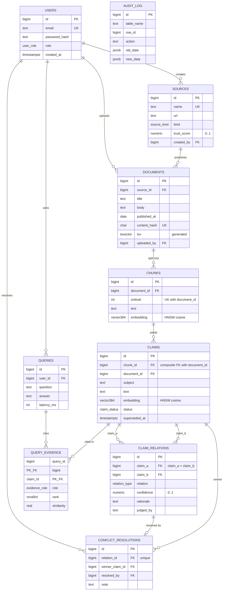

# ER diagram

Mermaid source; renders on GitHub. Export a PNG/PDF for the submission (mermaid.live or `npx @mermaid-js/mermaid-cli`).

`AUDIT_LOG` has no FKs on purpose: it must survive deletion of the rows it describes. It is written only by triggers on `claim_relations`, `conflict_resolutions`, `sources`.

## Normalisation notes

- 3NF throughout. `claims.document_id` is a deliberate, enforced denormalisation: the composite FK `(chunk_id, document_id) → chunks(id, document_id)` makes it impossible to disagree with the chunk, and it lets the "different document" filter and the claim→source join skip a hop on the hot path.
- `claim_relations` stores each unordered pair once (`claim_a < claim_b`, `UNIQUE (claim_a, claim_b)`).
- `query_evidence` resolves the M:N between queries and claims and carries the role/rank of each claim.

## Vector / retrieval data model (course item 4, vector part)

| Item | Decision |
|---|---|
| What is embedded | chunk text (retrieval) and claim text (conflict candidates) |
| Model | `Xenova/all-MiniLM-L6-v2`, 384 dims, run locally |
| Storage | `vector(384)` columns in `chunks` and `claims` |
| Metric | cosine distance (`<=>`); similarity = `1 - distance` |
| Index | HNSW `vector_cosine_ops` |
| Metadata | source, trust, publish date, status joined from relational tables at query time |
| Retrieval | top-k by cosine over `status = 'active'` claims, then `retrieve_conflicts` over that set |
